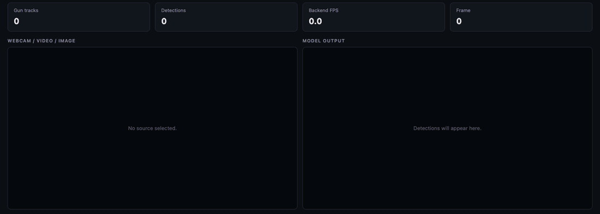
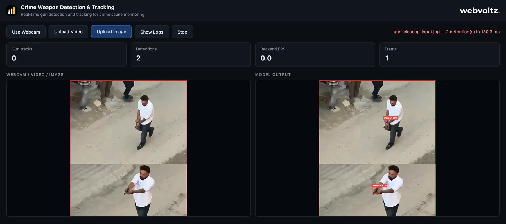
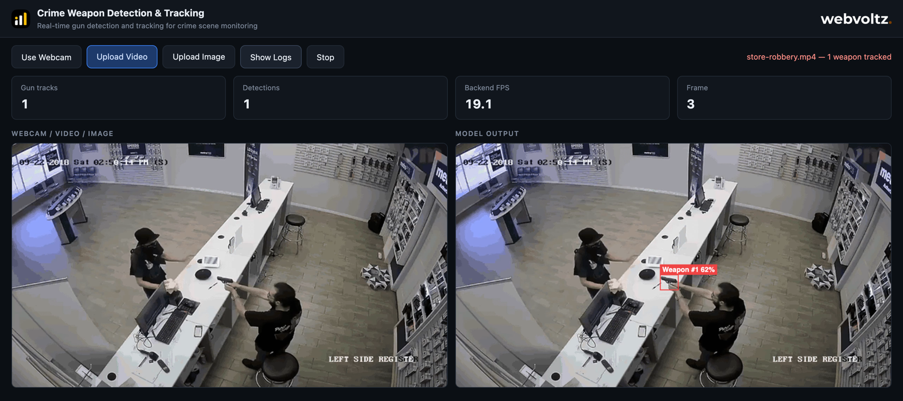
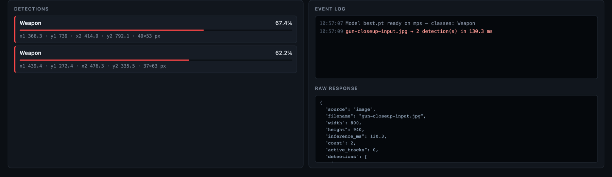

# Netram — Crime Weapon Detection & Tracking

A single FastAPI service that serves a web UI and runs a custom-trained YOLO
model (`best.pt`) over images, uploaded video and a live webcam. Video and
webcam frames also go through ByteTrack, so each weapon keeps a stable `#id`
while it stays in view. No login: it's a demo.

<p align="center">
  
</p>

---

## Run locally

### Requirements

- **Python 3.10+** (tested with Python 3.14 on macOS)
- An internet connection on first run: the model weights (`best.pt`, about 125 MB) are downloaded from the [v1.0.0 release](https://github.com/vish2293/netram-gun-detection/releases/tag/v1.0.0)
- A modern browser (Chrome, Edge, Firefox or Safari)
- Optional: an NVIDIA GPU (CUDA) or an Apple Silicon Mac (MPS). Without one, the app runs on CPU, more slowly.

### 1. Get the code

```bash
git clone git@github.com:vish2293/netram-gun-detection.git
cd netram-gun-detection
```

The model weights are not in the repo. On first start, `app.py` downloads
`best.pt` from the
[v1.0.0 release](https://github.com/vish2293/netram-gun-detection/releases/download/v1.0.0/best.pt)
and checks its size and SHA-256. If the file is missing, incomplete or
corrupt, it is downloaded again. To get it by hand instead (for example on an
offline machine), download it from that link and put it next to `app.py`.

### 2. Start the app

```bash
./run.sh
```

Then open <http://127.0.0.1:8000>.

On first run, the script creates `venv/` and installs `requirements.txt`
(PyTorch and Ultralytics are large, so this takes a few minutes). Later runs
start straight away. To do it by hand:

```bash
python3 -m venv venv
./venv/bin/python -m pip install -r requirements.txt
./venv/bin/python -m uvicorn app:app --host 127.0.0.1 --port 8000
```

When the model is loaded, the terminal prints:

```text
[weapon-detect] model ready on 'mps' — classes: ['Real Gun']
[weapon-detect] bytetrack bytetrack.yaml: track_buffer=20 frames
```

The device is `cuda`, `mps` or `cpu`, depending on your machine.

### 3. Try it

| Button | What it does |
| --- | --- |
| **Use Webcam** | Asks for camera access and runs tracked detection on the live feed |
| **Upload Video** | Plays an `.mp4` on loop and runs tracked detection on it |
| **Upload Image** | Runs a single detection on a `.png` or `.jpg` |
| **Show Logs** | Opens the detections list, event log and raw JSON response |
| **Stop** | Stops the webcam or video and closes the connection |

The webcam only works on `localhost` / `127.0.0.1` or over HTTPS. Browsers
block camera access on plain-HTTP network addresses.

### Troubleshooting

| Problem | Fix |
| --- | --- |
| `Could not download the model weights` | No internet access on first run. Download [`best.pt`](https://github.com/vish2293/netram-gun-detection/releases/download/v1.0.0/best.pt) by hand and put it next to `app.py`. |
| `Address already in use` | Something else is on port 8000. Stop it, or start uvicorn with `--port 8001`. |
| Webcam says "unavailable" | Allow camera access for the page, and make sure you're on `127.0.0.1`, not a LAN IP. |
| Very low FPS | You're probably on CPU. Check the device in the startup log, or in the event log under **Show Logs**. |
| Broken install after changing Python version | Delete `venv/` and run `./run.sh` again. |

---

## What it does

Netram watches footage and draws a red box around every gun it finds, with a
confidence score. On video and webcam, each gun also gets a track number
(`Weapon #1`, `Weapon #2`, …) that stays with it from frame to frame, so you
can tell one gun from another over time.

The page shows the input on the left and the model output on the right, with
four counters on top:

| Counter | Meaning |
| --- | --- |
| **Gun tracks** | Guns in the current frame that have a track ID |
| **Detections** | Boxes in the current frame |
| **Backend FPS** | Frames per second actually processed by the server (averaged over the last 15 replies) |
| **Frame** | Number of frames processed since the source started |

### Image detection

A single image is sent once over HTTP and comes back with boxes. There's no
tracking on still images, so labels show no `#id`.

<p align="center">
  
</p>

### Video and webcam tracking

Video and webcam frames go over a WebSocket, one at a time. ByteTrack links the
detections across frames so each gun keeps its ID.

<p align="center">
  
</p>

### Logs panel

**Show Logs** opens a panel with every detection in the current frame
(confidence bar and box coordinates), a timestamped event log and the raw JSON
the server returned.

<p align="center">
  
</p>

> Screenshots were taken from this app running locally on an Apple Silicon Mac
> (MPS). The test footage is publicly available CCTV and news footage, owned by
> its respective rights holders, and is not included in this repository.

---

## How it works

```text
 Browser (static/)                                FastAPI (app.py)
 ─────────────────                                ────────────────
 Upload Image ── POST /api/detect/image ────────▶  decode ─▶ YOLO predict ─▶ JSON boxes
                  (multipart file, ?conf=)

 Webcam / Video ─ draw frame to canvas
                  downscale to ≤ 640 px wide
                  JPEG q=0.7, base64
                ── WS /ws/detect {frame, conf, seq} ─▶ decode ─▶ YOLO track (ByteTrack)
                ◀────────────── {detections, inference_ms, active_tracks, …}
                  scale boxes back up, draw on output canvas
                  send next frame only after this reply
```

### Backend (`app.py`)

- **One model, loaded once.** `best.pt` is loaded at import time. On startup,
  two blank frames are run through it so the first real request doesn't pay
  the model's warm-up cost.
- **Device picked automatically.** CUDA if available, then Apple MPS, then CPU.
- **Images use `predict`, streams use `track`.** Still images run a plain
  `model.predict`. WebSocket frames run `model.track(..., persist=True)` with
  the settings in `bytetrack.yaml`, so IDs carry over between frames.
- **Inference off the event loop.** Every model call runs in a worker thread
  (`asyncio.to_thread`), so the server stays responsive while the model works.
- **Tracker reset per source.** Opening the socket, or sending
  `{"reset": true}`, clears the tracker so a new clip starts numbering from `#1`.
- **Nothing written to disk.** Frames are decoded in memory and discarded.
  Only boxes, labels and timings go back to the browser.

### Frontend (`static/`)

Plain HTML, CSS and JavaScript. No framework and no build step.

- **Self-throttling stream.** The browser sends one frame, waits for the
  reply, then sends the next. It never queues frames, so it runs at whatever
  pace the model can keep up with, and lag doesn't build up.
- **Smaller uploads.** Frames are downscaled to at most 640 px wide and sent as
  JPEG (quality 0.7). Boxes come back in that smaller size and are scaled up to
  the full-size canvas.
- **Display label.** The model's class is named `Real Gun`. The UI shows it as
  `Weapon` (see `DISPLAY_LABELS` in `static/app.js`). The raw JSON keeps the
  model's own name.

---

## The model

| | |
| --- | --- |
| File | `best.pt` (about 125 MB, from the [v1.0.0 release](https://github.com/vish2293/netram-gun-detection/releases/tag/v1.0.0)) |
| Architecture | YOLO26m, 21.8 M parameters |
| Classes | 1: `Real Gun` |
| Trained with | Ultralytics 8.4.126, 1280 px images, best epoch 65 of 100 |
| Validation precision | 0.880 |
| Validation recall | 0.767 |
| Validation mAP@50 | 0.838 |
| Validation mAP@50–95 | 0.494 |

These figures are read from the training metadata stored inside `best.pt`.
They measure the model on its own validation set, not on the footage shown
above.

The app runs inference at **640 px** (`INFER_SIZE`), half the training size,
which is faster. If small or distant guns are missed, raising `INFER_SIZE` to
`1280` usually helps, at the cost of speed.

---

## Configuration

Settings live at the top of `app.py` and in `bytetrack.yaml`. Restart the server after changing them.

### `app.py`

| Setting | Default | What it controls |
| --- | --- | --- |
| `DEFAULT_CONF` | `0.35` | Minimum confidence for a box to be shown. Lower finds more guns but adds false alarms. |
| `INFER_SIZE` | `640` | Image size the model runs at. Higher catches smaller guns, but is slower. |
| `MAX_UPLOAD_BYTES` | 50 MB | Largest image accepted by `/api/detect/image`. |
| `DETECTION_COLOR` | `#ef4444` | Box and label colour sent to the UI. |

Confidence can also be set per request, between 0.01 and 0.95: `?conf=` on the
image endpoint (values outside the range return `422`), or `conf` in each
WebSocket message (values outside the range are clamped).

### `static/app.js`

| Setting | Default | What it controls |
| --- | --- | --- |
| `CAPTURE_WIDTH` | `640` | Maximum width of video/webcam frames sent to the server |
| `DISPLAY_LABELS` | `{"Real Gun": "Weapon"}` | What the UI calls each model class |

### `bytetrack.yaml`

| Key | Value | Meaning |
| --- | --- | --- |
| `track_buffer` | `20` | Frames a lost gun keeps its ID before it's dropped |
| `track_high_thresh` | `0.5` | Confidence needed for the first matching pass |
| `track_low_thresh` | `0.1` | Lower-confidence boxes still used in the second matching pass |
| `new_track_thresh` | `0.5` | Confidence needed to start a new track |
| `match_thresh` | `0.8` | How strict box matching between frames is |
| `fuse_score` | `true` | Combine confidence with box overlap when matching |

A gun seen only at low confidence (between `DEFAULT_CONF` and
`new_track_thresh`) is still boxed, but may not get an `#id` until it scores
higher.

---

## API

The UI uses these endpoints, and you can call them directly too.

### `GET /api/meta`

Model and tracker info.

```json
{
  "model": "best.pt",
  "device": "mps",
  "classes": { "0": "Real Gun" },
  "color": "#ef4444",
  "default_conf": 0.35,
  "tracker": { "tracker_type": "bytetrack", "track_buffer": 20, "...": "..." }
}
```

### `POST /api/detect/image`

Detect guns in one image (no tracking).

```bash
curl -F "file=@photo.jpg" "http://127.0.0.1:8000/api/detect/image?conf=0.35"
```

```json
{
  "source": "image",
  "filename": "photo.jpg",
  "width": 800,
  "height": 940,
  "inference_ms": 261.2,
  "count": 2,
  "active_tracks": 0,
  "detections": [
    {
      "class_id": 0,
      "label": "Real Gun",
      "track_id": null,
      "confidence": 0.6738,
      "box": [366.3, 739.0, 414.9, 792.1],
      "color": "#ef4444"
    }
  ]
}
```

`box` is `[x1, y1, x2, y2]` in pixels of the uploaded image. Detections are
sorted by confidence, highest first.

Errors: `400` for an empty or undecodable file, `413` for a file over 50 MB.

### `WS /ws/detect`

Tracked, frame-by-frame detection.

Send, one message at a time:

```json
{ "frame": "data:image/jpeg;base64,...", "conf": 0.35, "seq": 1, "source": "video" }
```

Receive one reply per frame, in the same shape as the image response, plus
`seq` and a `track_id` on each detection. Send `{"reset": true}` to clear
tracker state (reply: `{"reset": true}`). A bad frame returns
`{"error": "..."}` and the socket stays open.

---

## Project structure

```text
netram-gun-detection/
├── app.py              FastAPI app: model loading, image endpoint, WebSocket tracking
├── best.pt             Trained YOLO26m weights, 1 class (downloaded on first run, not in git)
├── bytetrack.yaml      Tracker settings
├── requirements.txt    Python dependencies
├── run.sh              Creates venv/ on first run, then starts uvicorn on 127.0.0.1:8000
├── static/
│   ├── index.html      Page layout: toolbar, counters, input/output canvases, logs panel
│   ├── app.js          Capture, WebSocket client, box drawing, counters, logs
│   ├── style.css       Dark theme
│   ├── icon.png        Favicon and header icon
│   └── webvoltz.png    Header logo
└── docs/images/        Screenshots and GIF used in this README
```

---

## Tech stack

| Layer | Tools |
| --- | --- |
| Model | Ultralytics YOLO (YOLO26m), PyTorch |
| Tracking | ByteTrack (built into Ultralytics, uses `lap`) |
| Image handling | OpenCV, NumPy |
| Server | FastAPI, Uvicorn |
| Client | HTML, CSS, vanilla JavaScript, Canvas 2D, WebSocket |

---

## Known limits

This is a demo, not a production system.

- **One viewer at a time.** There is one model and one tracker for the whole
  server. Two browser tabs streaming at once share tracker state, and IDs get
  mixed up. Opening a new stream resets the tracker for everyone.
- **Boxes trail the video slightly.** Boxes are drawn on the latest video
  frame, while the result belongs to a frame sent a moment earlier. On fast
  motion, boxes can lag the gun by a frame or two.
- **One class.** The model only knows guns. It doesn't detect knives or people.
- **No security.** No login, no HTTPS and no rate limiting. The server listens
  on `127.0.0.1` only; don't expose it to a network as-is.
- **Unpinned dependencies.** `requirements.txt` takes the latest versions. The
  model was trained with Ultralytics 8.4.126; pin that version if a newer
  release breaks loading.
- **Browser file types.** The upload buttons accept `.mp4` video and
  `.png`/`.jpg` images. Other formats are filtered out by the file picker.

---

## Related

[Netram case study](https://github.com/viral-webvoltz/netram-weapon-detection-case-study):
a write-up of a larger version of this pipeline, with a second model for
people, a zoomed-in crop pass for small guns, and frame-synced output.

---

Built by [Webvoltz](https://webvoltz.com).
